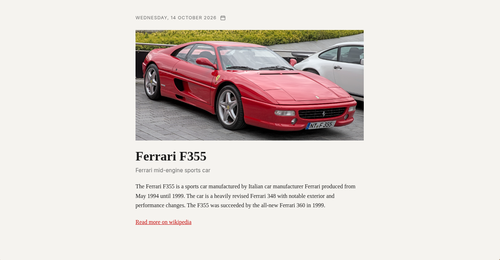

# Ferrari of the Day

A small web page that shows a different Ferrari every day, with a photo and a short write-up pulled from Wikipedia.



Live demo: https://sqnder0.github.io/ferrari-of-the-day/

## Quick start

Open the link above. That's it.

## Features

- A new car each day, picked from 30 road Ferraris ranging from the 250 GTO to the Purosangue.
- Each car gets its Wikipedia photo, a one-line description, the intro paragraph and a link to the full article.
- Click the calendar icon next to the date to jump back to any past day and see which car it had.
- Future dates are blocked. You get a message instead of a sneak peek.
- The same date always shows the same car, so you and a friend see the same one today.

## Running it locally

You need Node.js 20.19+ or 22.12+ (that's what Vite 8 asks for; the deploy workflow uses Node 22). No API keys or environment variables are needed.

```bash
git clone https://github.com/sqnder0/ferrari-of-the-day.git
cd ferrari-of-the-day
npm install
npm run dev
```

The dev server serves the page under the `/ferrari-of-the-day/` base path, so open http://localhost:5173/ferrari-of-the-day/ rather than the bare root.

`npm run build` writes a static site to `dist/`. Every push to `main` builds it and deploys it to GitHub Pages through `.github/workflows/deploy.yml`.

## How it works

There's no backend and no database. The car list is a hardcoded array, and the day's car is the number of days since 1970 modulo the length of that list. The fiddly part is getting that day number right. If you use `date.getTime()` directly, the number depends on your timezone and on daylight saving, so two people on the same calendar date could land on different cars, or the car could change at 1 a.m. Instead I take the local year, month and day and rebuild them with `Date.UTC`, which gives a clean midnight for that calendar date no matter where you are.

The date picker had a similar trap. `new Date("2025-03-10")` is parsed as UTC midnight, which is still March 9 anywhere west of Greenwich, so the page would show the wrong day. So I split the string from the date input and build the date from its parts by hand. Everything else comes from one call to Wikipedia's page summary endpoint, which returns the title, description, intro text and image together and allows browser requests, so the whole thing can live on GitHub Pages as plain static files.

## Credits

- Car text and photos come from [Wikipedia](https://en.wikipedia.org/) through its REST API. Article text is available under [CC BY-SA 4.0](https://creativecommons.org/licenses/by-sa/4.0/). The photos are hosted on Wikimedia Commons and each one has its own licence, listed on its file page.
- Built with [Vite](https://vite.dev/) (MIT).
- Ferrari is a trademark of Ferrari S.p.A. This is a fan project and has no connection to the company.
